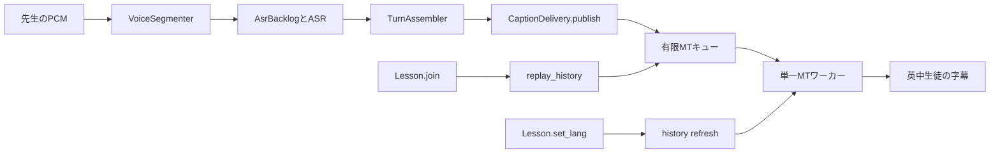

# 生徒の復元と授業中の字幕継続

生徒が再接続や言語切替を繰り返しても、先生から受理した新しい音声を、接続し続ける英語・中国語の生徒へ届ける。復元が共有の翻訳処理を占有すると、ASRの処理待ちまで増え、生徒全体の字幕が止まる。

## この接続部分を選んだ理由

[caption-recovery](../../.agents/skills/caption-recovery/SKILL.md) は復元対象の回収と宛先を調べるが、新着発話は混雑を作る入力として扱う。音声入力を通さず、MT容量8でライブ投入の容量待ちも発生させない。[morph-lesson](../../.agents/skills/morph-lesson/SKILL.md) と [teacher-continuity](../../.agents/skills/teacher-continuity/SKILL.md) は音声から英中字幕までを調べるが、生徒の再接続と履歴復元を除外している。

この検証は、両者の間にある共有MTキューとASR背圧を扱う。[Issue #131](https://github.com/s-ictokuyama-glitch/LinguaBridge/issues/131) の新着優先・古い言語への更新取消し・混雑時の更新打切りに沿う。途中字幕は既定OFFで、今回の次点とした。周期的な統計配信は授業入力に重ねる。

## 実装の接続

`publish` が満杯のMTキューを待つ間、ASRワーカーは次の音声へ進めない。先生の音声受信自体は続くため、検証はMTだけでなくASR待ちの保持量と破棄も観測する。

## 実コードを使う理由

Pythonのasyncio、標準Future、優先キュー、送信タスクの接続を別言語のモデルへ写すと、その写し間違いを別途管理する必要がある。既存の実コード検証に合わせ、有限操作列を全列挙し、同じ製品コードへ入力する方法を選んだ。TLA+やSMTによる証明ではなく、明示した入力とスケジュールの有界検査である。

検証のデータはPCM識別子、認識断片、期待する確定発話、接続世代、選択言語、未完了Futureで表す。`morph_lesson.LessonCase` の入力台帳と決定的な計算を再利用する。別のClassroom実装を一から作る案と比較し、PCM生成と期待値の重複を避けるためにこの構成を選んだ。正解は入力台帳から作り、製品の字幕履歴から作らない。

`Lesson.join`、`set_lang`、`leave` と実際の `Roster`・`ClientSender` を使う。ASRとMTの計算時間と結果だけを代役で制御する。実行中の復元MTは中断しない。新着優先の判定は、ライブと復元が両方ともキューへ入った時点から行う。満杯でライブ自身が投入待ちの状態とは分ける。

言語変更による履歴更新は混雑時に打ち切る契約なので、全履歴の到達を要求しない。再接続復元は1013切断による再試行を認める。固定生徒の新着字幕には欠落・重複・順序違反を認めない。再接続した生徒の復元には、新着との重複や順序逆転を許す。

## 検証結果

Windows、Python 3.12.10、`scripts/formal/requirements.txt` の固定依存で、スキルの主コマンドを実行した。製品コードは変更していない。

- 7操作・長さ0〜4の2,801候補中、合法1,083列が成功し、非合法1,718列を除外した。反例は0件。
- 新着優先、MT満杯、古い履歴更新の取消し、1013切断後の再回収の固定4ケースが成功した。
- 50分の仮想入力30,000フレームから新着600発話を確定し、固定生徒へ英中各600字幕を配信した。再参加300回、言語切替600回、統計配信1,504件を含む。
- 観測した保持量は上限内だった。ASR保持は最大1.7秒、履歴50件、キャッシュ512件、接続ごとの字幕受信控え100件、履歴更新残件18件、生存タスク8件だった。
- 14種類の製品コード破壊を一時コピーで検出した。すべて正常対照のPASS、子プロセスの終了コード1、指定した性質の違反を照合した。元コードでの全再実行もPASSで、結果が破壊前と一致した。

たとえばライブ優先度を復元より低くすると、復元1件目の完了後に新しい発話の英訳へ進まず、古い履歴2件目へ進む。`live_priority` がこの違いを検出する。古い履歴更新の識別確認を外すと、zhの履歴翻訳を待つ間にenへ切り替えた生徒へ、古いzh字幕を新しく送信予約し、`selected_language` に違反する。

独立レビューで、停止検査がタスクへの参照の消去だけを確認していた点を補強した。停止前のタスクを保持し、停止後に実際の終了を確認する。キャンセルせずに参照だけ消す破壊も `stop_completion` で検出した。

同期コミットは基の `localServer2` だけを取得した新規bare cloneでも解決し、対象製品コードと再利用する検証コードの差分がないことを確認した。`Model the Domain` の原則を入力台帳に、`Prove It Works` の原則を製品コードの破壊・復元とタスク実体の確認に適用した。

## 結果を読む際の限界

50分の入力は仮想時間であり、開発機やサーバーPCの処理性能を測らない。固定英中生徒が接続し続ける区間の履歴は翻訳済みになるため、長時間入力の復元負荷は主にキュー投入と配信である。未翻訳履歴がMTを占有する競合は、別の固定ケースで到達を確認する。

物理マイク、AudioWorklet、Sileroの判断、WebSocket受信と実LAN、生徒DOM、認識・翻訳の意味的な精度、実モデルの処理速度、推論ハング・失敗、記録保存は保証しない。これらは既存スキルと実時間試験の範囲である。

既知の [Issue #171](https://github.com/s-ictokuyama-glitch/LinguaBridge/issues/171) は、実モデルの授業動画リプレイで最大字幕遅延が8秒を超えた記録を持つ。本検証の仮想時間での成功は、その性能問題の解消を意味しない。

再実行手順、性質、探索上限、同期コミットは [student-continuity スキル](../../.agents/skills/student-continuity/SKILL.md) に記載する。基準結果は [student_continuity_baseline.json](student_continuity_baseline.json) に保存する。製品変更後の未確認差分を追うには `/maintain-formal-verification-skill` を使う。
